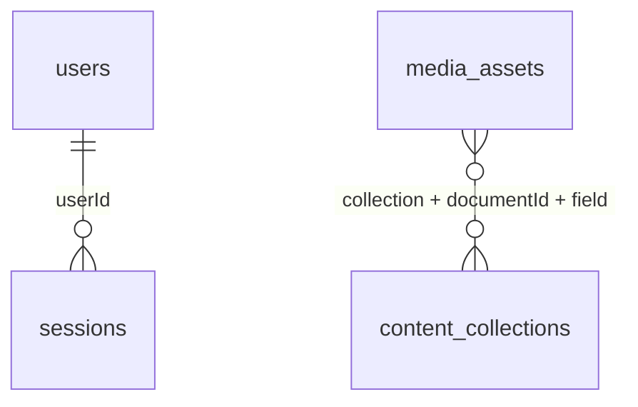

# MongoDB schema: familydent_web

The schema source of truth is `backend/src/database/schema.ts` and `backend/src/database/platform-schema.ts`. Collection validators run with
`validationLevel=strict` and `validationAction=error`. The API validates user input
before insertion; MongoDB independently enforces document shape.

## Content collections

| Public API type     | MongoDB collection    |
| ------------------- | --------------------- |
| `doctors`           | `doctors`             |
| `services`          | `services`            |
| `reviews`           | `reviews`             |
| `blogPosts`         | `articles`            |
| `clinicSpaces`      | `clinic_spaces`       |
| `concerns`          | `patient_concerns`    |
| `equipment`         | `equipment`           |
| `faq`               | `faqs`                |
| `metrics`           | `clinic_metrics`      |
| `pricing`           | `prices`              |
| `team`              | `team_members`        |
| `treatmentCases`    | `treatment_cases`     |
| `academyPrograms`   | `academy_programs`    |
| `tourismFeatures`   | `tourism_features`    |
| `tourismRoadmap`    | `tourism_steps`       |
| `tourismComparison` | `tourism_comparisons` |
| `tourismPackages`   | `tourism_packages`    |
| `tourismPlaces`     | `tourism_places`      |

Each content document has its own flat domain fields, an ObjectId `_id`, a stable
string `id`, numeric `sortOrder`, `publicationStatus` (`draft`, `published`, or
`archived`), optional numeric `revision` (legacy documents start at zero), and BSON Date `createdAt`/`updatedAt`. A doctor's `name`, `specialty`,
and `bio` are direct fields. The old `data` envelope is not stored.

All content collections have unique `id` and a compound publication/order index.
Collections with slugs also have unique `slug`. Public responses allow only the
explicit domain fields declared in the schema, hide internal fields, and return
only `published` records. An empty collection returns an empty array.

## Operational collections

| Collection              | Purpose and indexes                                                                                                                          |
| ----------------------- | -------------------------------------------------------------------------------------------------------------------------------------------- |
| `media_assets`          | Unique `localPath`, upload status, optional `cloudUrl`, references to collection/document/field. Indexed by status.                          |
| `users`                 | Name, normalized email, salted password hash, timestamps. Unique email. No plaintext password field is allowed.                              |
| `sessions`              | User ObjectId, SHA-256 token hash, creation and expiry Dates. Unique token hash, user index, TTL on `expiresAt` with `expireAfterSeconds=0`. |
| `bookings`              | Contact details, selected treatment/doctor, preferred BSON Date, source, workflow status, timestamps. Indexed by status/date and phone/date. |
| `tourism_consultations` | Contact details, country, service and message, source, workflow status, timestamps. Indexed by status/date and phone/date.                   |
| `schema_migrations`     | Applied schema/content initialization markers and migration counts.                                                                          |

MongoDB does not enforce cross-collection foreign keys. Session creation receives
the inserted user's ObjectId; verification checks dangling sessions and media
references. Media records retain local paths when no cloud URL is ready.

Workflow statuses are `new`, `confirmed`, `completed`, and `cancelled`. Requests
are separate from confirmed clinical appointments: the old clinical system remains
outside the website database and application account's access scope.

Users have a server-assigned role, active/disabled status, password hash version and session revocation version. Sessions carry that version; changing a password or logout-all invalidates older generations, including an in-flight login. Missing legacy versions mean zero.

Booking userId/createdAt indexes support account-scoped queries. An application and its outbox event are created in one transaction; MongoDB Atlas or a replica set is required. Runtime uses primary reads and majority writes.
